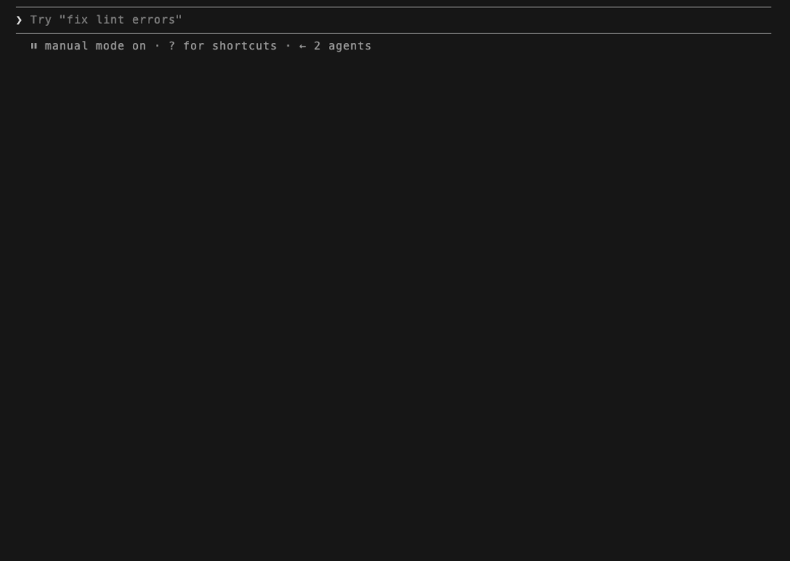

# personal-vault

A Claude Code plugin that answers questions from local folders of notes: an Obsidian vault or any tree of `.md` and `.txt` files.

Notes are embedded by a model you host and stored on your machine. Claude reads the matching chunks and answers with `path:line` citations.



## Requirements

The plugin installs none of these; both must be on your machine before the first `index`.

| Needed | Install | Check |
|---|---|---|
| [uv](https://docs.astral.sh/uv/) | `brew install uv` | `uv --version` |
| An OpenAI-compatible embedding server with a model | [Ollama](https://ollama.com), then `ollama pull bge-m3` | `curl localhost:11434/api/version` |

The embedding server must be running whenever you index or ask: the question is embedded with the same model as the notes. If something is missing, the command stops and prints what to install.

Any other OpenAI-compatible server works (HF TEI, vLLM, LM Studio, OpenAI): pass `host=` and `model=` to `index`.

Nothing else is needed: the vector store (Qdrant) runs inside the plugin's Python process, on files in `~/.personal-vault/`. The first command takes a few seconds longer while `uv` installs the Python dependencies.

## Install

```
/plugin marketplace add <path or git URL of this repo>
/plugin install personal-vault@personal-vault
```

## Use

```
/personal-vault:index path=~/notes name=notes default=true
/personal-vault:index name=notes
/personal-vault:ask what did I write about TLS termination?
/personal-vault:ask vault=notes replicas=3 nerede ayarlı?
```

### `index`

| Parameter | Default | Meaning |
|---|---|---|
| `path` | required for a new vault | Folder to index |
| `name` | derived from the folder name | Vault name |
| `default` | `false` | Make this vault the default |
| `host` | `http://localhost:11434` | Embedding server: Ollama, HF TEI, vLLM, LM Studio, OpenAI |
| `model` | `bge-m3` | Embedding model; pick a multilingual one for mixed-language notes |
| `query_prefix` | empty | Text before every question, for models that need one (e5: `query: `) |
| `doc_prefix` | empty | Text before every chunk (e5: `passage: `) |
| `exclude` | empty | Comma-separated globs on the relative path; replaces the stored list |
| `store` | empty | Qdrant server URL; empty uses the embedded store |
| `rebuild` | `false` | Embed everything again |

Settings are remembered per vault. Set `PERSONAL_VAULT_API_KEY` if the server needs a bearer token.

### `ask`

`vault=<name>` first, then the question. Without `vault`, the default vault is used; with a single vault, that one.

The search returns the 16 closest chunks, plus up to 4 chunks from notes linked with them: notes a hit links to with `[[wikilinks]]` or markdown links, and notes that link to a hit.

### `vaults`

```
/personal-vault:vaults
/personal-vault:vaults default=notes
/personal-vault:vaults remove=notes
```

Lists every vault with its path, model, chunk count, index size and last index time; changes the default; or deletes a vault's index after asking. Removing a vault never touches the notes.

## How indexing works

- Walks the folder recursively, skipping directories that start with a dot (`.obsidian`, `.git`, `.trash`).
- Splits each note at headings, then into chunks of at most 1500 characters. Neighbouring sections are packed into one chunk while they fit, so a note of many small sections does not become many small chunks. The note title and heading path are embedded with each chunk.
- Stores the links of each chunk (`[[Note]]`, `[[Note|alias]]`, `[[Note#heading]]`, `[text](note.md)`). Links are matched by note file name, as Obsidian does; two notes with the same file name are both candidates.
- Each file's content hash is stored with its chunks. Unchanged files are skipped, changed files have all old chunks replaced, renamed files keep their vectors, deleted or newly excluded files are removed.
- Changing the model, the document prefix or the chunker rebuilds the index, because the old vectors are not comparable.

Paths matching `*password*`, `*passwd*`, `*secret*`, `*credential*`, `*şifre*`, `*sifre*` or `*.env*` are never indexed.

## Privacy

The index holds the text of your notes and lives in `~/.personal-vault/` (override with `PERSONAL_VAULT_HOME`), outside this repo. With a local embedding server nothing leaves your machine at index time; a non-local `host` receives your note text, and the CLI warns. At question time the matching chunks go to Claude, like any file Claude Code reads.

## Storage

Vectors are stored with Qdrant, in one of two modes. The mode is chosen per vault with `store=`.

| | Embedded (default) | Server |
|---|---|---|
| Parameter | none | `store=http://localhost:6333` |
| Needs a running Qdrant | No | Yes, whenever you index or ask |
| Data lives in | `~/.personal-vault/index/<name>/` | The Qdrant server's own storage |
| Search | Compares every vector | HNSW index |
| Good for | Up to ~20,000 chunks | Larger vaults, or one Qdrant shared with other tools |

### Embedded

Nothing to set up. `qdrant-client` runs the store inside the plugin's Python process and writes a SQLite file. No Qdrant process, no Docker, no port. Every command loads the whole collection into memory first, so start-up time grows with the vault.

Above 20,000 chunks the library prints a warning on each command. Search still works; it is a hint to move to a server.

### Server

Start Qdrant:

```
docker run -d -p 6333:6333 -v qdrant_data:/qdrant/storage qdrant/qdrant
```

Index a vault against it:

```
/personal-vault:index path=~/notes name=notes store=http://localhost:6333
```

The address is remembered for that vault. Each vault is one collection, named after the vault. Use a recent image (`docker pull qdrant/qdrant`): the client warns when the server is more than one minor version behind it.

### Switching an existing vault

Data is not migrated. Giving `store=` to a vault that was indexed in embedded mode embeds every note again, and the old SQLite file stays on disk until you delete `~/.personal-vault/index/<name>/`.

## Limits

- Dense search only; the `ask` skill adds a plain text search for exact identifiers.
- One process at a time per vault in embedded mode.

## Development

```
uv run pytest
uv run personal-vault --help
uv run personal-vault eval --file questions.json
```

`eval` measures retrieval on your own vault. The file is a JSON list of `{"question": "...", "path": "<note path relative to the vault>"}`; the command prints how often the expected note is among the hits. Run it before and after a change to chunking or to the model. Keep the file outside the repo: it describes your notes.

Design notes: [plan/design.md](plan/design.md).

The demo above is recorded from [demo/demo.tape](demo/demo.tape) over the sample notes in [demo/notes](demo/notes); the tape's header lists the commands that regenerate it.
